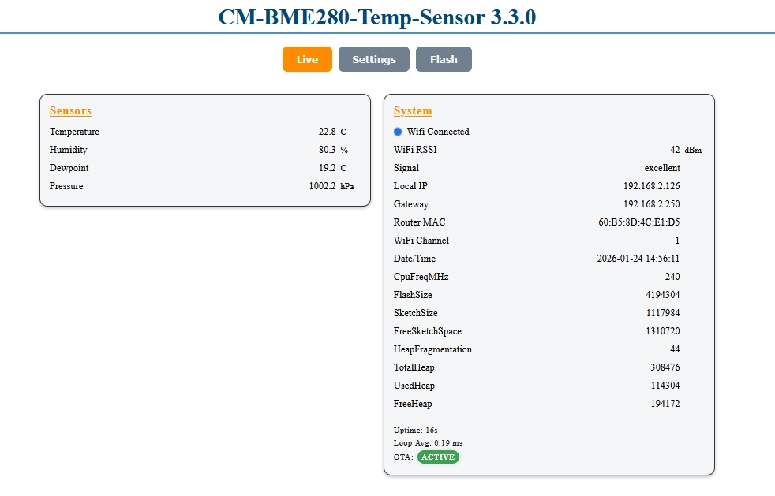
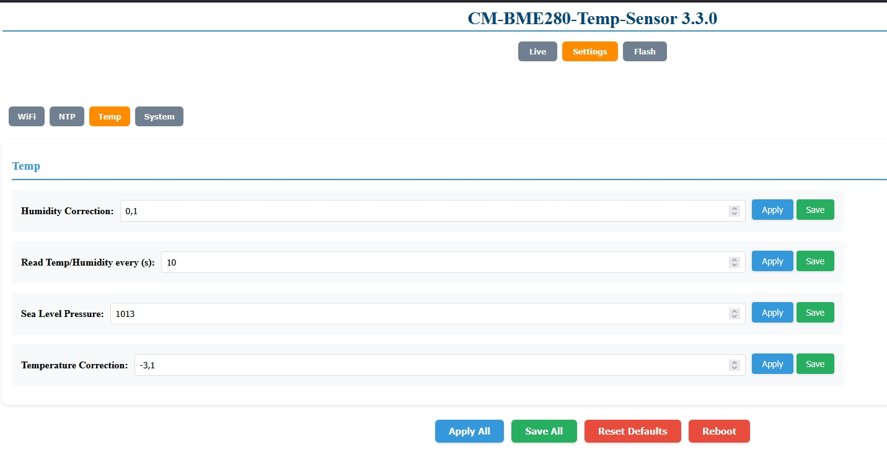

# CM BME280 Temp Sensor Demo (BME280-Temp-Sensor)

This example shows a simple temperature/humidity/pressure setup based on a BME280 sensor and the ConfigurationsManager Web UI.

## What it demonstrates

- Core settings templates: WiFi + System + NTP via `cm::CoreSettings`
- Settings-driven WiFi startup via `ConfigManager.startWebServer()` (DHCP/static/AP fallback)
- WiFi lifecycle hooks via `cm::CoreWiFiServices` (OTA init + NTP sync ticker)
- One runtime provider with four compact `RuntimeFloatMeta` fields for live sensor values
- Sparse temperature styling and an existing legacy alarm field in the same runtime layout
- Periodic sensor reads via `Ticker`

## Hardware

- ESP32 (e.g. NodeMCU-32S)
- BME280 (I2C)

Default pins (see `src/main.cpp`):

- SDA: GPIO21
- SCL: GPIO22

## How to run

From the repo root:

```bash
pio run -d examples/BME280-Temp-Sensor -e usb
pio run -d examples/BME280-Temp-Sensor -e usb -t upload
```

## Runtime metadata

`setupRuntimeUI()` registers one `sensors` provider for temperature, humidity,
pressure and dew point. Each value uses a scoped `RuntimeFloatMeta` definition;
the manager owns its compact stored representation after registration. The
source group, page, card, subgroup, units, precision and ordering match the
previous live-builder layout. Temperature styling uses the sparse
`setRuntimeFieldStyle()` extension. The condensation warning remains registered
through `AlarmManager` to demonstrate legacy and compact fields together.

## First start / AP mode

The example loads existing NVS settings without automatically writing network
or OTA defaults. It does not import WiFi credentials from `secret/secrets.h` or
replace the saved OTA password. Provision WiFi, static network settings and OTA
credentials through the existing Web UI. The settings-page password can still
be supplied using the `SETTINGS_PASSWORD` build definition.

If no SSID is configured yet, the device starts in AP mode.
Open the printed AP URL from Serial (usually `http://192.168.4.1`) and configure WiFi via the Web UI.

## Screenshots




